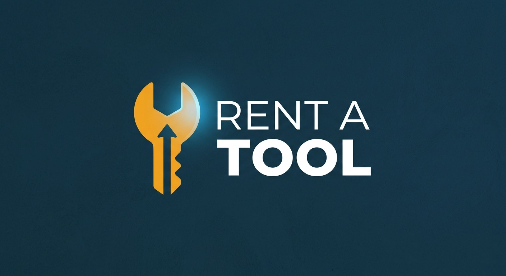
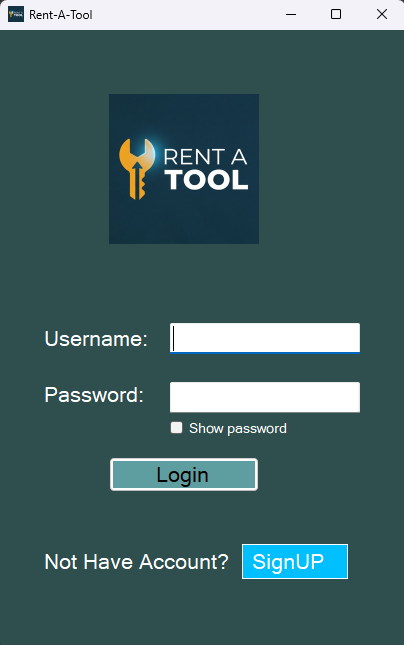
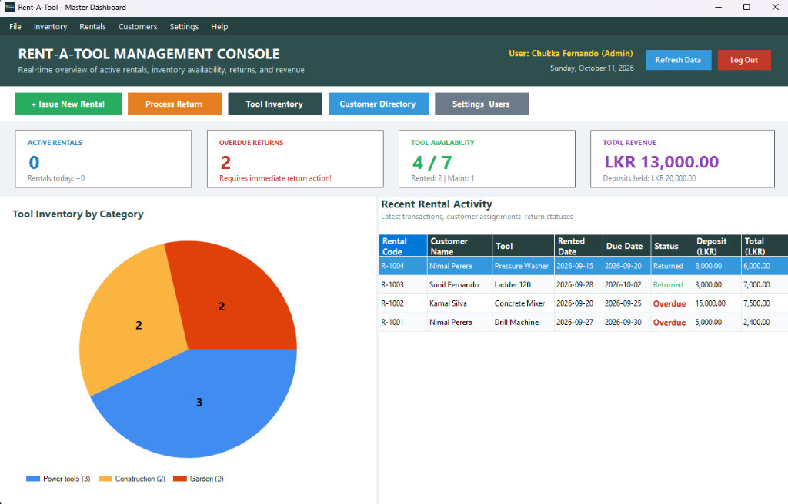
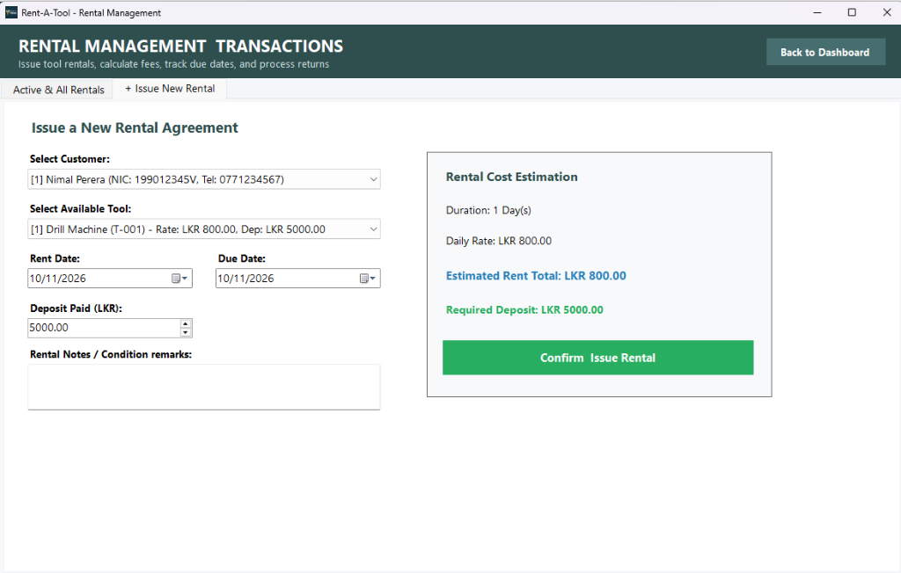
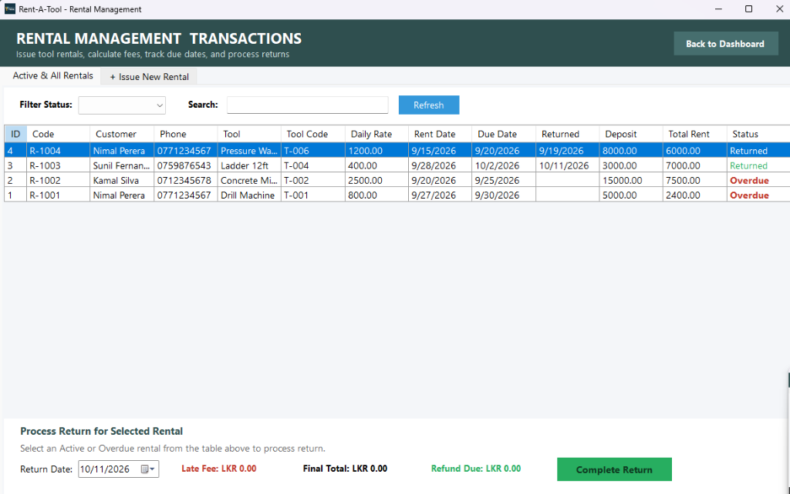
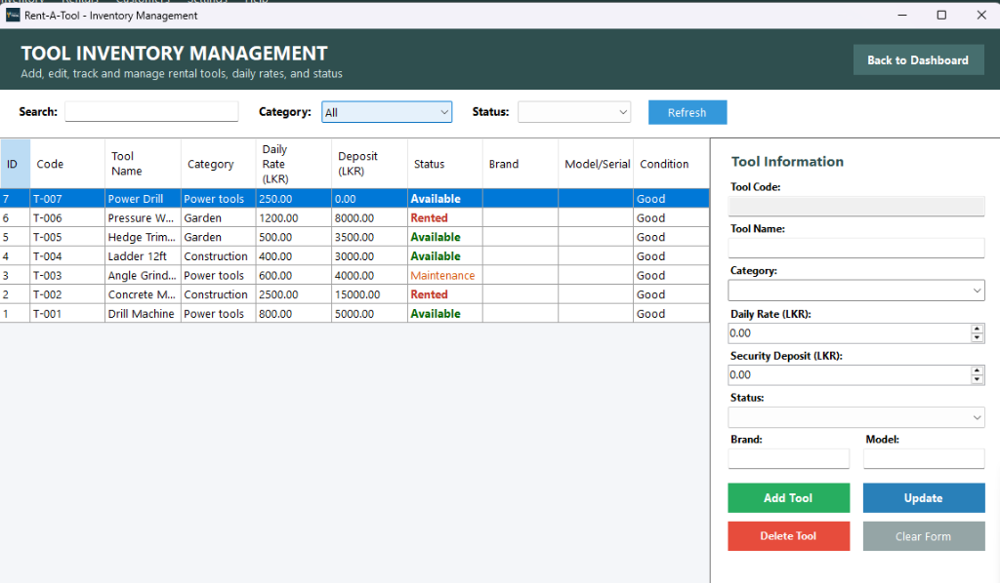
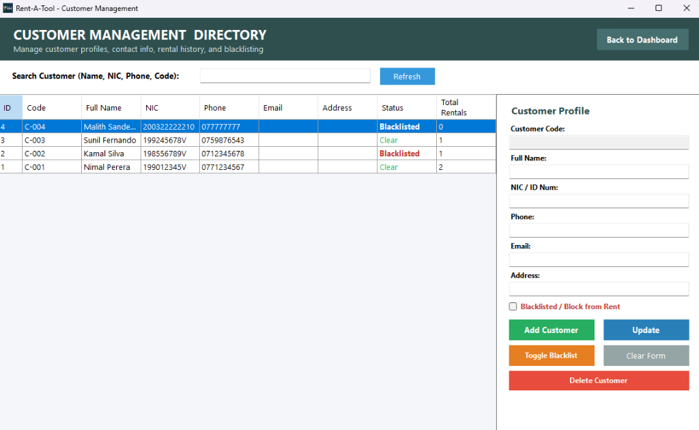
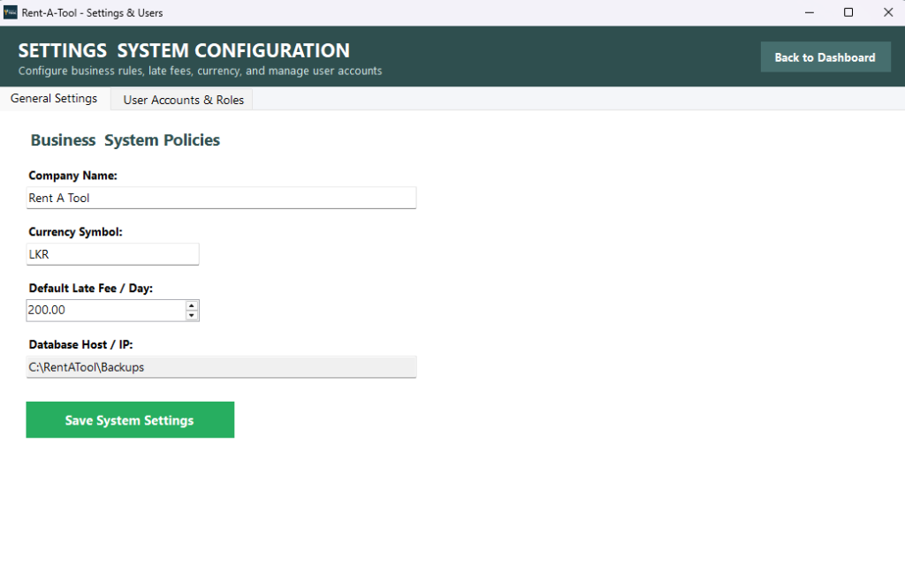

<p align="center">
  
</p>

<h1 align="center">Rent-A-Tool</h1>

<p align="center">
  A Windows desktop application for managing tool rentals — inventory, customers, rentals, returns, and payments.
</p>

<p align="center">
  
  
  
  
  
  
</p>

---

## ✨ Features

| Module | Description |
|---|---|
| 🔐 **Login / Sign Up** | Role-based access control (Admin / Cashier) with password hashing |
| 📊 **Dashboard** | KPI cards (rentals today, overdue, revenue, available tools), pie chart, recent activity table |
| 🧰 **Tool Inventory** | Add, edit, delete tools; track availability status |
| 📝 **Rentals** | Create rentals with customer, tools, dates & deposit; track active rentals |
| 👤 **Customers** | Customer profiles, rental history, blacklist flag |
| ⚙️ **Settings** | Rental rates, late fee rules, user management, backup |

---

## 🚀 Run Without Visual Studio (Recommended)

> Download the pre-built release — no installation of Visual Studio required.

### Step 1 — Download

Go to [**Releases**](https://github.com/1st-Year-2nd-Semester-Project/Rent-A-Tool/releases) and download **`Rent-A-Tool-v1.0.zip`**.

### Step 2 — Install Prerequisites (one-time, on the target PC)

| Requirement | Download |
|---|---|
| **.NET Framework 4.7.2** | Pre-installed on Windows 10/11. If missing → [Download](https://dotnet.microsoft.com/en-us/download/dotnet-framework/net472) |
| **VC++ Redistributable 2022 (x86)** | Required to run the app → [Download vc_redist.x86.exe](https://aka.ms/vs/17/release/vc_redist.x86.exe) |
| **MySQL Server 8.0+** | Required for the database → [Download MySQL Installer](https://dev.mysql.com/downloads/installer/) |

### Step 3 — Configure Database

1. In your MySQL server, create the database and import the schema:
   ```sql
   CREATE DATABASE rent_a_tool;
   ```
   Then import `Data/schema.sql` (from the source code).

2. Open `Rent-A-Tool\Rent-A-Tool\Data\DbConfig.h` and set your connection details:
   ```cpp
   String^ server   = "localhost";   // or your MySQL server IP
   String^ database = "rent_a_tool";
   String^ user     = "root";
   String^ password = "your_password";
   ```

### Step 4 — Run

Extract the zip and double-click **`Rent-A-Tool.exe`**.

```
Rent-A-Tool-v1.0\
├── Rent-A-Tool.exe      ← double-click to run
├── MySql.Data.dll       ← MySQL connector (included)
└── assets\
    └── icon.ico
```

---

## 🛠️ Build from Source

### Prerequisites

- **Visual Studio 2022** with:
  - ✅ Desktop development with C++
  - ✅ C++/CLI support
  - ✅ .NET Framework 4.7.2 targeting pack
- **MySQL Server 8.0+**
- **MySQL Connector/NET 8.x** installed at `C:\Program Files (x86)\MySQL\MySQL Connector NET\`

### Steps

1. **Clone the repository**
   ```bash
   git clone https://github.com/1st-Year-2nd-Semester-Project/Rent-A-Tool.git
   cd Rent-A-Tool
   ```

2. **Set up the database**
   ```sql
   CREATE DATABASE rent_a_tool;
   -- then import Data/schema.sql
   ```

3. **Update connection string**  
   Edit `Rent-A-Tool/Rent-A-Tool/Data/DbConfig.h` with your MySQL credentials.

4. **Open the solution**  
   Open `Rent-A-Tool/Rent-A-Tool.sln` in Visual Studio 2022.

5. **Build**
   - Configuration: **Release** (for distribution) or **Debug** (for development)
   - Press `Ctrl+Shift+B` or go to **Build → Build Solution**

6. **Run**  
   Press `F5` or find the exe in `Rent-A-Tool/Rent-A-Tool/Release/Rent-A-Tool.exe`

### Build via Command Line (MSBuild)

```powershell
& 'C:\Program Files\Microsoft Visual Studio\2022\Community\MSBuild\Current\Bin\MSBuild.exe' `
  'Rent-A-Tool\Rent-A-Tool\Rent-A-Tool.vcxproj' `
  /t:Build /p:Configuration=Release
```

---

## 📁 Project Structure

```
Rent-A-Tool/
├── Rent-A-Tool/
│   ├── dashboard.h / .cpp       # Dashboard form — KPI cards, chart, recent rentals table
│   ├── loginform.h / .cpp       # Login form
│   ├── Signupform.h / .cpp      # Sign-up form
│   ├── inventory.h / .cpp       # Tool inventory management
│   ├── rentals.h / .cpp         # Rentals management
│   ├── customers.h / .cpp       # Customer management
│   ├── settings.h / .cpp        # App settings
│   ├── Data/
│   │   ├── DbConfig.h           # MySQL connection string
│   │   └── schema.sql           # Database schema
│   └── Rent-A-Tool.vcxproj      # Visual Studio project file
├── assets/
│   ├── logo.png                 # App logo
│   └── icon.ico                 # Window icon
└── README.md
```

---

## 📸 Screenshots

### Login


### Dashboard


### Rentals — Issue New Rental


### Rentals — Active & All Rentals


### Tool Inventory Management


### Customer Management Directory


### Settings — General Configuration



---

## 🗺️ Roadmap

- [x] Role-based login (Admin / Cashier)
- [x] Dashboard KPI cards, category pie chart, recent activity table
- [x] Tool inventory management
- [x] Rentals management with deposit tracking
- [x] Customer management with blacklist support
- [x] Settings — rates, late fees, user management
- [x] Automatic late-fee calculation on overdue rentals
- [x] Custom window icon and modern UI redesign
- [ ] Payment history & printable receipts
- [ ] Reports export (Excel / PDF)
- [ ] Email notifications for overdue rentals
- [ ] Barcode / QR scanner support for tools

---

## 🤝 Contributing

Pull requests are welcome! For major changes, please open an issue first to discuss what you'd like to change.

1. Fork the repo
2. Create your feature branch: `git checkout -b feature/my-feature`
3. Commit your changes: `git commit -m "feat: add my feature"`
4. Push to the branch: `git push origin feature/my-feature`
5. Open a Pull Request

---

## 📄 License

This project is licensed under the **MIT License** — see the [LICENSE](LICENSE) file for details.
